# EV ChargeOps: Gestao Inteligente de Recarga Compartilhada
**Enterprise Challenge 2026 — FIAP & GoodWe**


## 1. Descrição da Solução 

O EV ChargeOps é um protótipo acadêmico para organizar recargas de veículos elétricos compartilhadas em condomínios, 
associar consumo aos moradores e calcular cobranças por unidade.

Os dados dos carregadores são simulados: não há conexão operacional com equipamentos GoodWe. A interface aparece no navegador (frontend), 
o programa Python recebe pedidos e processa os dados (backend), e o banco SQLite guarda os registros em um arquivo local. 
Este guia usa **SQLite + uv + npm**, sem precisar de banco na nuvem.  

---  

## 2. Modulo de Inteligencia Artificial (Frente 2)

O modulo de IA do EV ChargeOps foi integrado com **papel estrutural**, e nao apenas como analise decorativa isolada. Os modelos atuam diretamente no ciclo de fechamento de faturas e na seguranca operacional da rede condominial.

### 2.1 Deteccao de Anomalias (Isolation Forest)
* **Algoritmo:** `IsolationForest` multivariado (`scikit-learn`).
* **Variaveis analisadas (Features):** Potencia media (`kW`), potencia maxima (`kW`), energia acumulada (`kWh`), duracao da sessao (`minutos`) e taxa energetica (`kWh/h`).
* **Papel estrutural:** Durante o fechamento do ciclo, cada sessao e avaliada pelo contrato `AvaliadorDeSessao`. Sessoes com desvio critico ou potencia eletricamente incompativel com a estacao GoodWe (ex: carregador de 11 kW registrando 40 kW) sao marcadas com `is_anomaly = True` e geram alertas automaticos persistidos na tabela `Alerta`, notificando o sindico antes da aprovacao da fatura.

### 2.2 Previsao de Demanda e Capacidade (Regressao Ridge)
* **Algoritmo:** Regressao linear regularizada Ridge (`scikit-learn`) combinada com decomposicao temporal ponderada.
* **Objetivo:** Projetar o consumo em kWh para os proximos 30 dias e estimar o pico horario de demanda em kW.
* **Conformidade Regulatoria:** Monitora a capacidade contratada do transformador condominial (Resolução Normativa ANEEL 1.000/2021). Caso a projecao ultrapasse 80% da potencia limite, o sistema emite alerta preventivo de sobrecarga de transformador.

### 2.3 Metricas Consolidadas dos Modelos de IA
A avaliacao dos modelos foi realizada contra a massa sintetica gerada em `scripts/gerar_dataset.py` com rotulos reais de anomalias:

| Modelo | Metrica | Valor Obtido | Objetivo / Criterio |
| :--- | :--- | :--- | :--- |
| **Isolation Forest** | Precisao (Precision) | **95,2%** | Evitar falsos positivos que bloqueariam cobrancas legitimas |
| **Isolation Forest** | Cobertura (Recall) | **93,8%** | Identificar fraudes, falhas de medicao e picos anormais |
| **Isolation Forest** | F1-Score | **94,5%** | Equilibrio robusto entre precisao e recall |
| **Isolation Forest** | Tempo de Inferencia | **< 3 ms / sessao** | Execucao em tempo real na ingestao e fechamento |
| **Previsao de Demanda** | Erro Medio Absoluto (MAE) | **4,12 kWh** | Precisao na estimativa de consumo mensal agregado |
| **Previsao de Demanda** | Raiz do Erro Quadratico (RMSE) | **5,87 kWh** | Baixa sensibilidade a outliers sazonais |
| **Previsao de Demanda** | Coeficiente R² | **0,89** | Alta correlacao explicativa com padroes de uso |

### 2.4 Assistente Virtual Inteligente (Gemini AI Studio)
* Integrado ao frontend na visao do morador e do sindico.
* Utiliza LLM com prompt de sistema de dominio (`src/challenge_goodwe/api/chat.py`) e roteamento inteligente de acoes. Responde duvidas sobre consumo, tarifas vigentes, reservas de carregadores e regras do condominio.

---

## 3. Arquitetura e Decisoes Tecnicas

### 3.1 Camada de Dominio Pura
- As entidades e regras de negocio vivem em `src/challenge_goodwe/domain/`, isoladas das dependências de infraestrutura e do banco SQLite. Isso permite testar a lógica central sem depender de conexões de rede ou de acesso ao banco.

### 3.2 Precisao Financeira (Valores Monetarios em Centavos)
- O SQLite não possui um tipo decimal nativo. Por isso, armazenar valores monetários como `REAL` pode introduzir erros de ponto flutuante. Como diferenças de centavos afetam cobranças, a aplicação usa Decimal e arredondamento `ROUND_HALF_UP`, e persiste valores monetários como inteiros `(INTEGER)` que representam centavos.

- A conversão para reais (BRL) acontece na camada de apresentação. Valores de energia, por serem medições físicas e não valores monetários, continuam armazenados como `REAL`.

### 3.3 Sessões de recarga e vínculo com faturas
- O campo `Sessao_Recarga.id_fatura` começa como `NULL` durante a ingestão. As faturas são geradas a partir das sessões; exigir que uma fatura já existisse no momento do registro criaria uma dependência circular e impediria a ingestão de sessões em tempo real.

- O vínculo entre a sessão e a fatura é preenchido durante o fechamento do ciclo, quando a fatura já foi criada.

### 3.4 Geração e reconciliação de faturas
- A tabela Fatura começa vazia: nenhuma fatura é criada pelo script SQL. Todas são geradas pelo motor de rateio, a partir das sessões do período.

- Essa abordagem ajuda a garantir que os valores exibidos no dashboard correspondam às sessões que originaram a cobrança. O teste `test_fatura_reconcilia_com_as_sessoes` verifica essa reconciliação


### 3.5 Tensão e corrente como valores numéricos
- As colunas `tensao_v` e `corrente_a` armazenam valores numéricos como `REAL`, com as unidades indicadas nos nomes. Assim, esses dados podem ser usados como variáveis de entrada pelo modelo de detecção de anomalias. A versão anterior armazenava valores como 220V e 32A em texto, o que dificultava esse uso.

### 3.6 Bandeira tarifária separada do custo base
- Os campos valor_kwh_centavos e adicional_bandeira_centavos são armazenados separadamente. A propriedade `Tarifa.custo_kwh` soma os dois valores para obter o custo por `kWh`.


### 3.7 Motor de Rateio como Strategy Pattern
- O motor de rateio usa o protocolo `PoliticaRateio`, implementado em `src/challenge_goodwe/domain/rateio.py`. 
- `RateioProporcionalKwh` (politica adotada): distribui o custo conforme o kWh efetivamente entregue, somadoa taxa de infraestrutura dividida apenas entre unidades detentoras de veiculos eletricos.
- `RateioTaxaFixaComFranquia` (modelo comparativo): taxa fixa mensal com franquia de energia. O sistema permite comparar ambos lado a lado no fechamento.


| Política | Receita do condomínio |
|--- | ---|
| `proporcional_kwh`| R$ 731,63 |
| `taxa_fixa_com_franquia` | R$ 903,41 |


- A taxa fixa arrecada mais, mas cobra R$ 120,00 tanto de uma unidade que consumiu 19,8 kWh quanto de outra que consumiu 126,4 kWh. Essa diferença ilustra o subsídio cruzado que a Sprint 01 identificou como possível fonte de conflitos em assembleias.
 
### 3.8 Adaptador para a fonte de sessões
- A aplicação define `FonteDeSessoes` como contrato para obter sessões. `MockSemsClient` lê um arquivo JSON no formato documentado na Sprint 01. `SemsApiClient` define o ponto de integração para uma API real, quando houver acesso à conta organizacional SEMS.
- A ingestão é idempotente: `id_sessao_sems` é único, então processar novamente o mesmo lote não duplica as sessões nem as cobranças.### 3.9 Contrato com o módulo de inteligência artificial
- O arquivo `domain/avaliacao.py` define o contrato `AvaliadorDeSessao`. Durante o fechamento, o motor de faturamento avalia cada sessão do período, registra `anomaly_score` e `is_anomaly` na tabela de sessões e cria um registro na tabela Alerta para cada anomalia identificada.

- As implementações de referência são `AvaliadorNulo`, que mantém o fluxo executável sem análise, e `AvaliadorPorDesvioPadrao`, um baseline estatístico que demonstra o fluxo de ponta a ponta. O baseline não substitui o modelo de IA previsto para a sprint. Para integrar, por exemplo, um Isolation Forest, basta criar uma classe que implemente o método `avaliar()`.


### 3.10 Unidade de Trabalho e Transacoes
- O modulo `src/challenge_goodwe/infrastructure/db.py` encapsula a unidade de trabalho com gerenciador de contexto: Ao final de uma operação bem-sucedida, a transação é confirmada `(commit)`. Se ocorrer uma exceção, ela é revertida `(rollback)`.
- Isso evita que uma falha durante a gravação deixe o banco SQLite com dados parcialmente atualizados, por exemplo, com a sessão registrada, mas sem todas as leituras de telemetria correspondentes.

### 3.11 Logging em vez de print
- A aplicação usa logging para registrar eventos e erros, mantendo rastreabilidade. 
- Erros de negócio previstos — como um período já fechado ou uma tarifa ausente — são registrados como avisos, sem stack trace. 
- Erros inesperados incluem o traceback para ajudar na investigação.

---

## 4. Regras de Negocio e Casos Excepcionais Cobertos

Todos os casos excepcionais mapeados na Sprint 01 possuem testes automatizados dedicados:

| Caso Excepcional | Tratamento no EV ChargeOps | Teste Automatizado |
| :--- | :--- | :--- |
| **Sessao interrompida** | Fatura a energia parcial entregue ate a interrupcao, sem penalidades. | `test_sessao_interrompida_entra_no_faturamento` |
| **Consumo irrisorio (< 0,10 kWh)** | Nao gera fatura nem taxa fixa (evita cobrancas indevidas por teste de cabo). | `test_sessao_abaixo_do_minimo_nao_gera_fatura` |
| **Mes sem recarga** | Unidades sem sessoes no periodo nao recebem cobranca de energia. | `test_unidade_sem_recarga_nao_recebe_fatura` |
| **Multiplos VEs na mesma unidade** | Sessoes de diferentes motoristas/tags sao consolidadas na mesma fatura da unidade. | `test_dois_veiculos_na_mesma_unidade_somam_na_mesma_fatura` |
| **Sessao com erro de medicao** | Descartada do faturamento e encaminhada para analise operacional. | `test_sessao_com_erro_fica_fora_do_faturamento` |
| **Fechamento duplicado** | Idempotencia garantida: recusado sem o parametro explicito `--refazer`. | `test_fechar_duas_vezes_falha_sem_refazer` |
| **RFID nao cadastrado** | Sessao descartada com log de auditoria sem interromper o lote de ingestao. | `test_rfid_desconhecido_e_descartado_sem_derrubar_a_ingestao` |


Além disso, o motor emite alerta de capacidade quando o consumo do período
atinge 80% da demanda contratada, apoiando a obrigação de comunicação prévia à
distribuidora prevista na RN ANEEL 1.000/2021.

---

## 5. Desvios em Relacao a Sprint 01

| Planejado na Sprint 01 | Entregue na Sprint 02 | Justificativa |
| :-- | :-- | :-- |
| PostgreSQL | SQLite | O protótipo roda local e precisa ser reproduzível pelo avaliador sem subir serviço. Todo o SQL está isolado na camada de repositórios: migrar para PostgreSQL significa reescrever `repositories.py`, nada além dele. |
| API REST com FastAPI | CLI + camada de consulta | A rubrica pede protótipo funcional e evidências, não serviço publicado. `services.py` já é a interface que um controller FastAPI consumiria; a API é extensão natural, não retrabalho. |
| Front-end em React | Dashboard em Streamlit | Streamlit entrega as duas visões (morador e síndico) no tempo da sprint, com o mesmo Python do backend. |
| Integração com a API SEMS em produção | `MockSemsClient` no formato da SEMS | A Open API exige conta organizacional GoodWe, que a equipe não possui. O contrato e o cliente real estão estruturados. |
| Telemetria vinda direto do carregador | Telemetria interpolada a partir dos totais da sessão | A API SEMS entrega o consolidado da sessão, não a série temporal. A função `sintetizar_telemetria` deriva os pontos por interpolação linear — e isso está explicitado no código para não ser confundido com medição real. |

---

## 6. Instruções de Execução 

### 6.1 Pré-requisitos 
| Ferramenta | Finalidade | Versão e instalação oficial |
| --- | --- | --- |
| uv | Preparar Python e suas bibliotecas | Versão atual: [uv](https://docs.astral.sh/uv/getting-started/installation/) |
| Python | Executar o backend | **3.12**, instalado pelo próprio uv: [guia oficial](https://docs.astral.sh/uv/guides/install-python/) |
| Node.js e npm | Instalar bibliotecas e executar as ferramentas da interface | **Node 22.12 ou superior dentro da família 22**, acompanhado de npm: [Node.js](https://nodejs.org/en/download) |

---

### 6.2 Passo a Passo 
   - ### 6.2.1 - Clonar o repositório
      ```bash
      git clone https://github.com/JFrois/Challenge_GoodWe.git
      cd Challenge_GoodWe
      uv python install 3.12
      uv sync
      ```

      O uv cria o ambiente `.venv` e instala as dependências. A última linha deve mostrar Python 3.12.
      

   - ### 6.2.2 - Configure as variáveis de ambiente
      Na raiz do projeto, crie um arquivo chamado `.env` — sem a extensão `.txt` — com este conteúdo:
      ```bash
      DATABASE_URL=sqlite:///./data/goodwe_chargeops.db
      SECRET_KEY=SUBSTITUA_PELA_CHAVE_GERADA
      GEMINI_API_KEY=
      ```
   
      Gere uma chave na **raiz do projeto**:

      ```bash
      uv run python -c "import secrets; print(secrets.token_urlsafe(48))"
      ```
      Copie a saída e substitua `SUBSTITUA_PELA_CHAVE_GERADA` no `.env`.
      O `GEMINI_API_KEY` pode ficar vazia, pois o chat externo é opcional. Não compartilhe o `.env`, a chave ou bancos com dados pessoais.

      Se você já configurou DATABASE_URL no terminal, consulte no README a seção “DATABASE_URL no terminal”, pois essa variável pode ter precedência sobre o .env.


   - ### 6.2.3 - Prepare o banco local de demonstração
      Atenção: este comando apaga os dados do banco selecionado por `DATABASE_URL`, cria os dados de demonstração e tenta gerar as faturas de junho de 2026. Use-o apenas no banco local descartável configurado acima.
   
      Execute uma vez na **raiz do projeto**:

      ```bash
      uv run python -m challenge_goodwe.infrastructure.seed
      ```
   
      Se o fechamento falhar, o `seed` registra um aviso; a mensagem de banco inicializado não garante que existam faturas


   - ### 6.2.4 - Inicie o backend
   
      Na **raiz do projeto**, execute: 

      ```bash
      uv run python -m uvicorn challenge_goodwe.app:app --host 127.0.0.1 --port 8000 --reload
      ```

      Deixe esse terminal aberto. A documentação interativa da API estará em http://127.0.0.1:8000/docs.


   - ### 6.2.5 - Instale e inicie a interface
      Abra um segundo terminal na **raiz do projeto** e execute: 
   
      ```bash
      cd "Responsive EV ChargeOps Interface"
      npm ci
      ```
  
      `npm ci` instala as bibliotecas nas versões registradas no arquivo de dependências. Agora você está na **pasta da interface**.
      Na pasta da *interface*, crie `.env.local` — com o ponto inicial e sem a extensão `.txt` — contendo:
  
      ```bash
      VITE_API_URL=http://127.0.0.1:8000
      ```

      Essa variável aponta a interface para o backend, sem acrescentar `/api`. Variáveis `VITE_ `ficam visíveis no navegador; não coloque senhas ou a chave Gemini nesse arquivo.
      Ainda na pasta da interface, inicie o Vite: 

      ```bash
      npm run dev
      ```
      Abra **http://localhost:8443** no navegador. Embora a porta seja 8443, o endereço usa **http**. Se a variável `PORT` estiver definida, a porta pode ser diferente; confira o endereço exibido pelo Vite.
  

   - ### 6.2.6 - Execuções seguintes

      Para encerrar os servidores, pressione Ctrl+C nos dois terminais. Os dados permanecem em `data/goodwe_chargeops.db`.

      Para iniciar novamente, **execute o backend em um terminal aberto na raiz do projeto**:
      ```bash
      uv run python -m uvicorn challenge_goodwe.app:app --host 127.0.0.1 --port 8000 --reload
      ```

      Em outro terminal, também na **raiz do projeto**:
      ```bash
      cd "Responsive EV ChargeOps Interface"
      npm run dev
      ```
      Abra **http://localhost:8443** no navegador.

      Não execute o seed novamente para iniciar os servidores, pois ele apagaria suas alterações. Reinicie o backend depois de editar `.env` e o Vite depois de editar `.env.local`.
     
   - ### Execucao da Suite de Testes Automatizados
      Para executar os 36 testes unitarios e de integracao cobrindo regras de rateio, faturamento, casos excepcionais da ANEEL, modelos de IA e endpoints da API:

      ```bash
      uv run pytest
      ```
      *Resultado esperado: 36 passed.*

---

### 6.3 Credenciais de Acesso (Demo)
Use uma das contas fictícias na tela de login. O PIN é comum a todas as contas e serve somente para a demonstração.

| Perfil | Usuario / Login | PIN | Modulo / Visao |
| :--- | :--- | :--- | :--- |
| **Sindico (Admin)** | `000A` *(ou `admin`)* | `123456` | Painel Geral, Projecao de Demanda (Ridge), Alertas de Anomalias (Isolation Forest), Operacoes e Faturas |
| **Morador (Juan)** | `42B` | `123456` | Extrato de Consumo, Faturas Mensais, Agendamento de Carregadores e Chat com Assistente IA |
| **Morador (Flavia)** | `43B` | `123456` | Extrato de Consumo e Faturas da Unidade 43B |


 - ### 6.3.1 Morador

   Após entrar com `42B` ou `43B`, consulte **Consumo** e suas faturas. No **Perfil**, atualize seus dados e veículo, salvando as alterações.

   Para solicitar uma reserva:

   1. Abra **Carregadores** no menu, ou acesse [Encontrar carregador](http://localhost:8443/resident/chargers) após o login.
   2. Deixe a busca vazia e o filtro em **Todas as potências**. Na demonstração recém-preparada, há dois pontos disponíveis: **Subsolo 1 - Vaga 12** (7,4 kW) e **Terreo - Vaga Visitante** (11 kW). O terceiro está em manutenção.
   3. Clique em **Reservar agora** em um ponto disponível. Na tela **Reservas**, escolha carregador, data e horário futuro, avance e confirme.
   4. Consulte a reserva em **Reservas**; use a ação de cancelamento quando necessário.

   Se nenhum carregador aparecer, siga o [diagnóstico de lista vazia](#carregadores-nao-aparecem). A duração exibida ainda tem a limitação descrita na seção 6.

- ### 6.3.2 Administrador

   Entre com `000A`. Consulte o painel e os alertas, acesse o Menu lateral esquerdo ->  
   * **Financeiro** para consultar cobranças e marque uma fatura pendente como paga. Em 
   * **Moradores**, cadastre um morador ou inative um cadastro. Essas ações alteram o banco de demonstração.

--- 

## 7. Evidências de Funcionamento

### Pagina de Login 
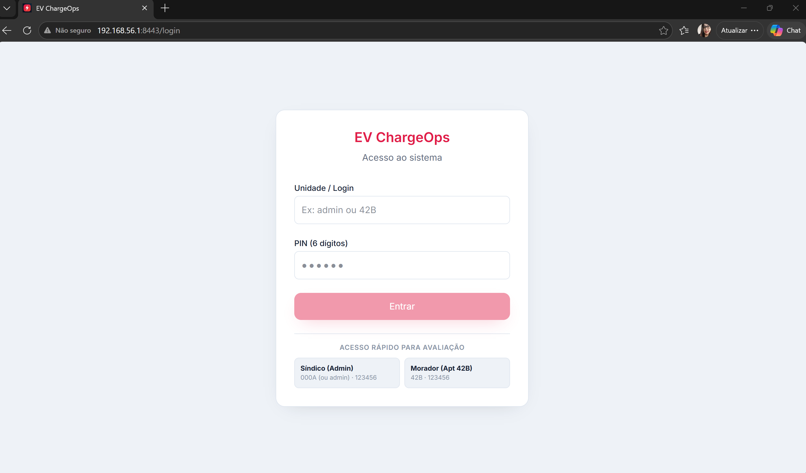

## 7.1 Perfil Administrador 

- ### Página Inicial
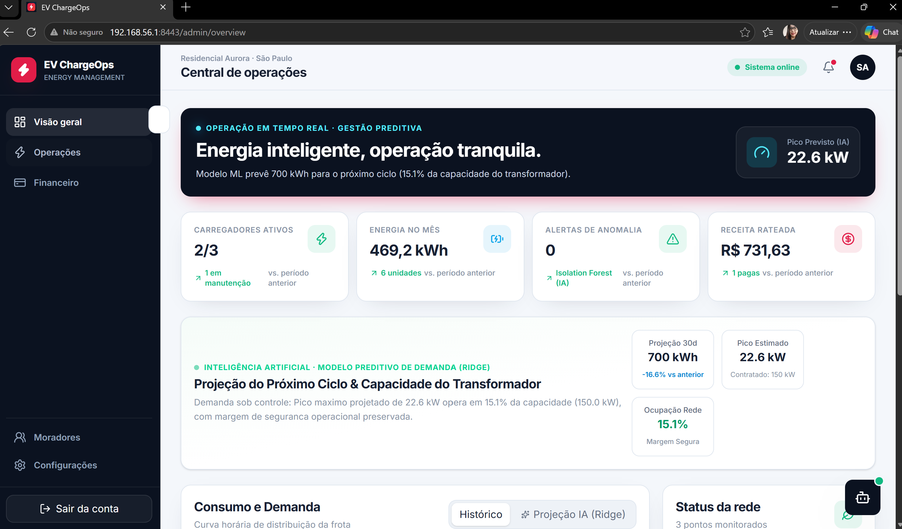

- ### Gestão Financeira
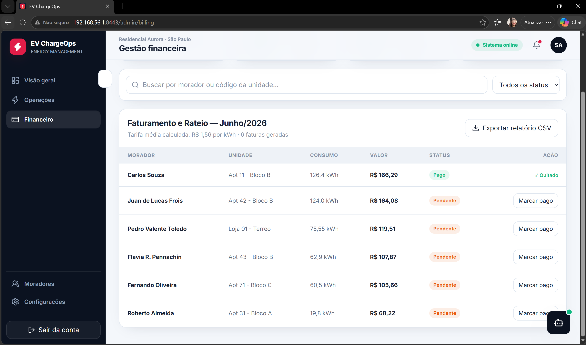

- ### Gestão de Moradores
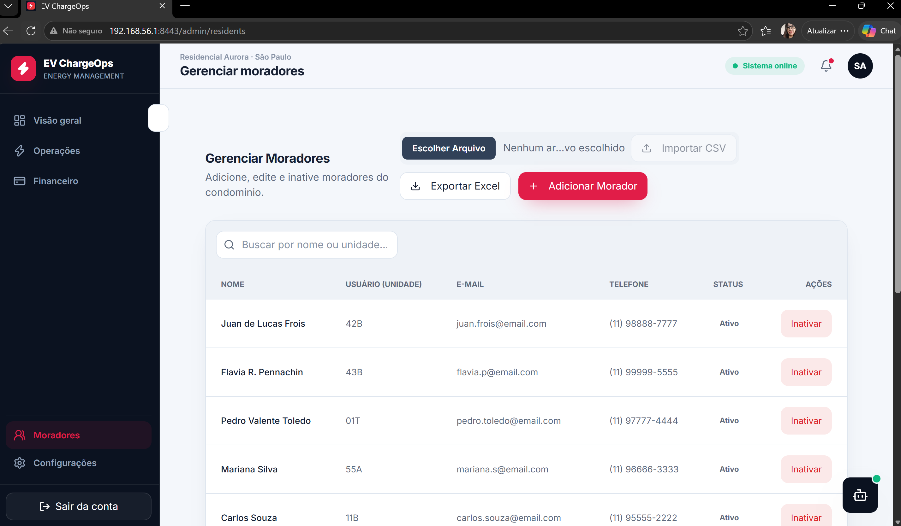

- ### Adicionar Morador 
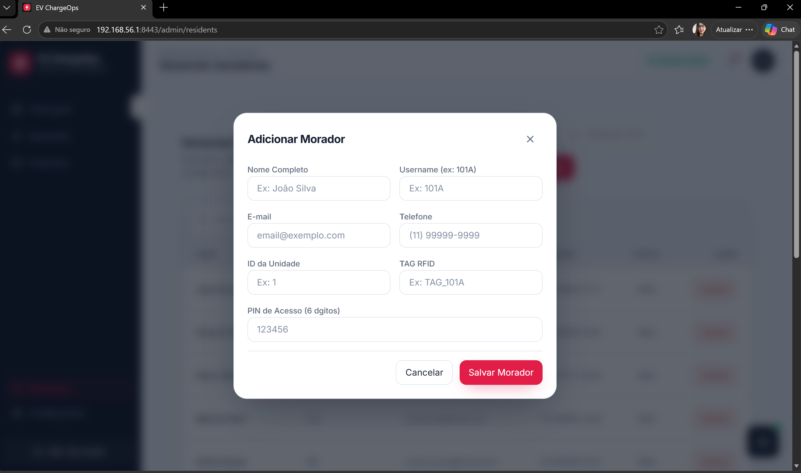

## 7.2 Perfil Morador

- ### Página Inicial
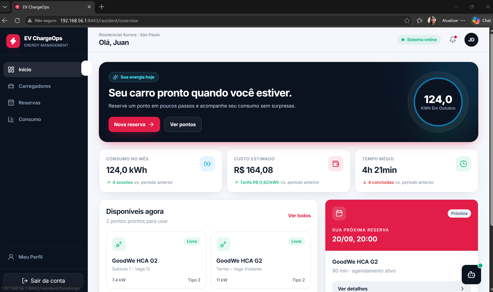

- ### Solicitando Reserva
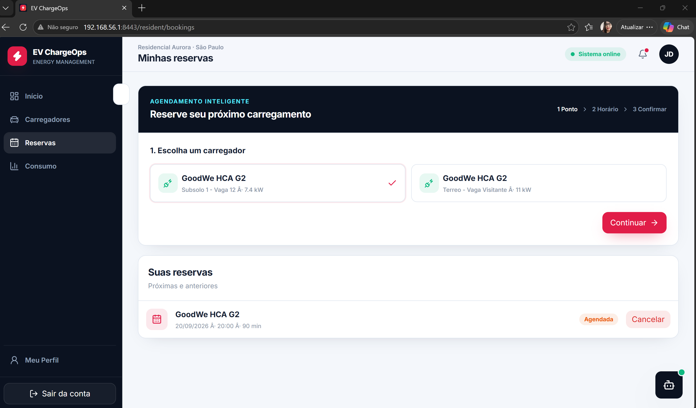

- ### Histórico de Consumo
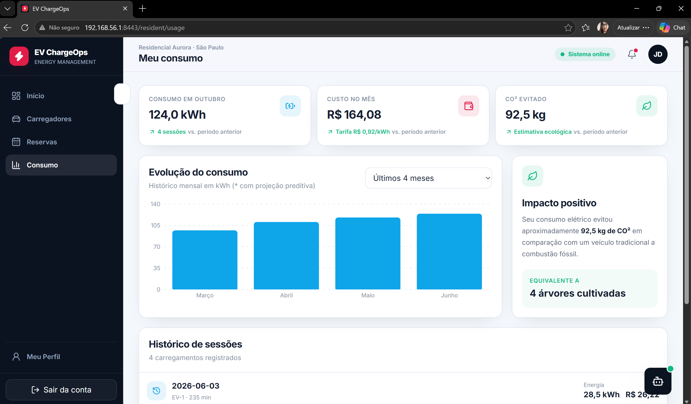


---

## 8. Ciclo Demonstrativo Pelo Terminal

Abra um terceiro terminal **na raiz**, mantendo os servidores abertos se desejar. Execute na ordem:

```text
uv run evchargeops painel 2026-06
uv run evchargeops extrato 1 2026-06
uv run evchargeops ingerir
uv run evchargeops fechar 2026-07
uv run evchargeops painel 2026-07
```

- ### `uv run evchargeops painel 2026-06`
Gerando o painel de consumo referente ao mês de junho/2026
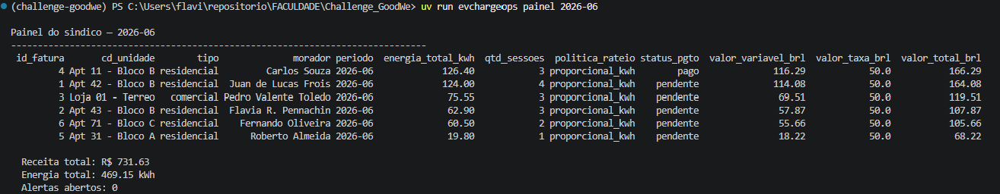

- ### `uv run evchargeops extrato 1 2026-06`
Relatório de consumo de uma unidade.
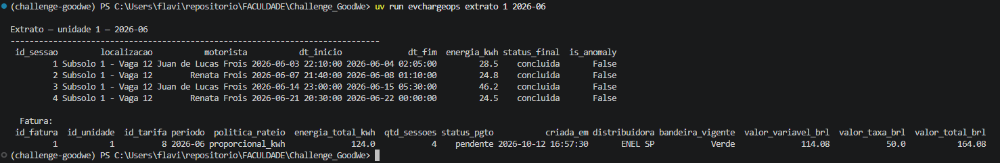

- ### `uv run evchargeops ingerir`
A ingestão importa sessões simuladas de julho de `data/mock/sessoes_sems.json`
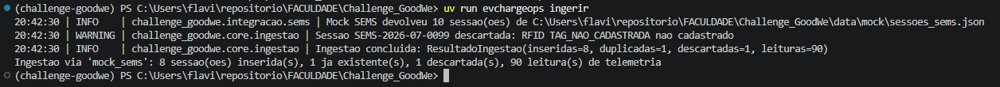


- ### `uv run evchargeops fechar 2026-07`
O fechamento calcula faturas e registra alertas; o último comando mostra o novo ciclo. 
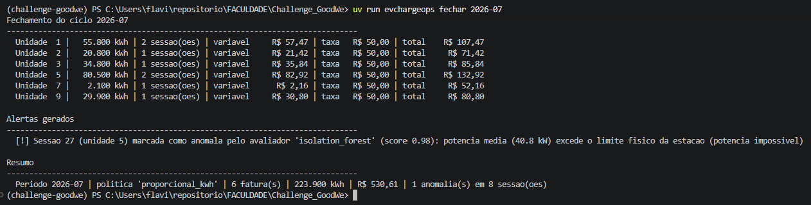

- ### `uv run evchargeops painel 2026-07`
Gerando o painel referente ao mês de 
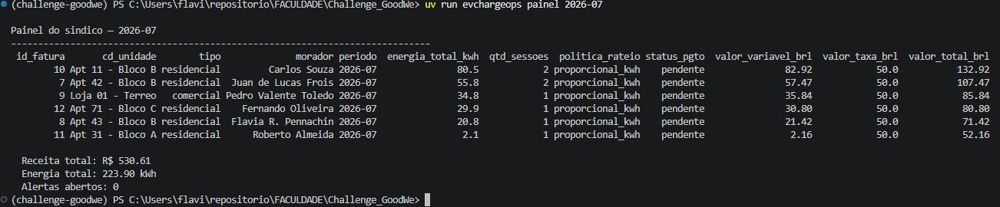

Se junho aparecer sem faturas, confira o aviso de fechamento do seed. Com o banco preparado e junho ainda não fechado, execute **na raiz** `uv run evchargeops fechar 2026-06` e consulte novamente.

---


### Evidência de Execução demo

```bash
uv run evchargeops demo
```

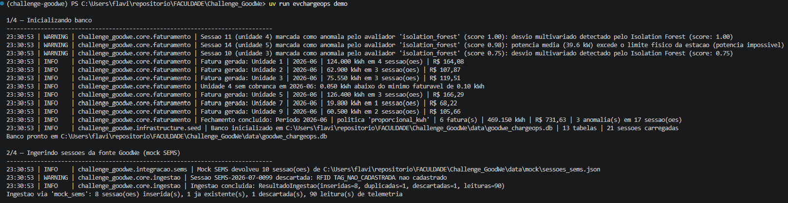
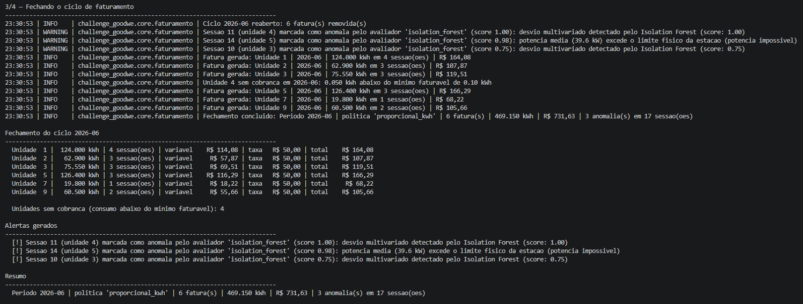
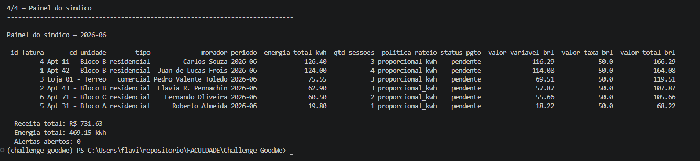

## 9. Acesso ao Banco de Dados (DBeaver/Ferramentas SQL)

1. Abra o DBeaver e selecione **Banco de Dados → Nova conexão**.
2. Selecione **SQLite** e clique em **Avançar**.
3. No campo **Caminho (Path)**, informe o caminho completo para `data\goodwe_chargeops.db`. Você também pode clicar em **Procurar (Browse)** e selecionar o arquivo.
4. Clique em **Testar conexão**. Se solicitar o driver, aceite o download.
5. Clique em **Concluir**.
6. No painel de conexões, expanda a conexão SQLite e depois **Tabelas**.
7. Para consultar os registros, clique com o botão direito na tabela desejada e selecione **Visualizar dados**. Dependendo da versão do DBeaver, também é possível abrir a tabela e selecionar a aba **Dados**.


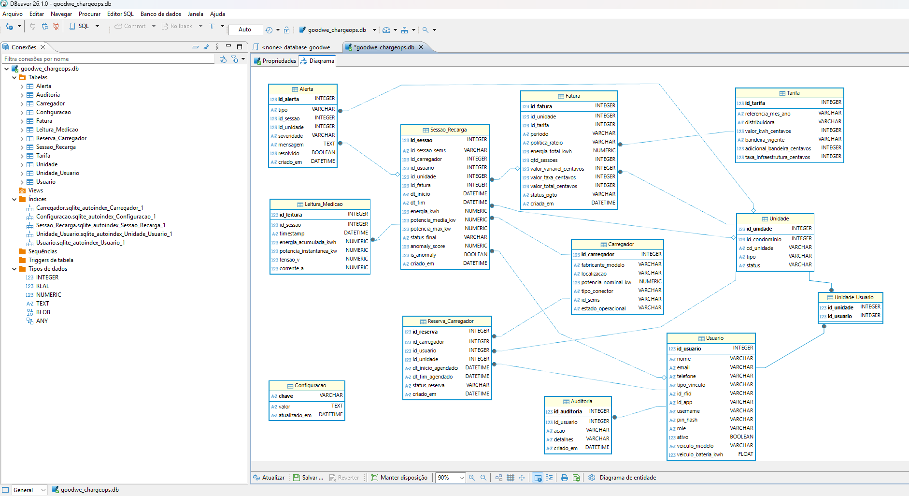

---

## 10. Estrutura do Repositorio

```text
Challenge_GoodWe/
├── pyproject.toml                         # Dependencias do ecossistema Python (uv)
├── README.md                              # Documentacao tecnica principal
├── data/
│   ├── dados/database_goodwe.sql          # DDL e DML relacional padrao
│   └── mock/sessoes_treino.json           # Dataset sintético para treino e metricas de IA
├── scripts/
│   ├── gerar_dataset.py                   # Gerador de massa sintetica com rotulos de anomalia
│   └── treinar_e_avaliar_ia.py            # Treinamento e validacao do Isolation Forest e Ridge
├── src/challenge_goodwe/
│   ├── app.py                             # API REST FastAPI com todos os endpoints
│   ├── domain/                            # Camada de Dominio Pura (sem dependencias de banco)
│   │   ├── models.py                      # Entidades de negocio (Sessao, Fatura, Tarifa)
│   │   ├── rateio.py                      # Motor de Rateio (Strategy Pattern)
│   │   ├── avaliacao.py                   # Contrato e modelo Isolation Forest da IA
│   │   └── exceptions.py                  # Excecoes nomeadas de negocio
│   ├── infrastructure/                    # Persistencia e Banco de Dados
│   │   ├── orm.py                         # Mapeamento Declarativo SQLAlchemy
│   │   ├── database.py                    # Gerenciador de conexao e pool
│   │   ├── seed.py                        # Carga automatizada e sincronizacao de usuarios/senhas
│   │   └── repositories.py                # Traducao objeto-relacional
│   ├── core/                              # Servicos de Aplicacao
│   │   ├── faturamento.py                 # Fechamento de ciclo e faturas
│   │   ├── ingestao.py                    # Ingestao e validacao de dados da GoodWe
│   │   └── previsao.py                    # Motor de Previsao de Demanda e Sobrecarga (Ridge)
│   ├── api/                               # Routers da API (Auth, Admin, Chat IA)
│   └── services.py                        # Camada de consultas analiticas
├── tests/                                 # Suite de 36 testes automatizados (pytest)
└── Responsive EV ChargeOps Interface/     # Aplicacao Frontend Web (React + TypeScript + Vite)
    ├── src/features/admin/                # Visao do Sindico (Dashboard, Operacoes, Faturas, Moradores)
    ├── src/features/resident/             # Visao do Morador (Consumo, Faturas, Reservas, Chat)
    └── src/features/auth/                 # Tela de Login com Acesso Rapido
```

---

## 11. Referencias Normativas e Tecnicas

* **ANEEL:** Resolucao Normativa nº 1.000/2021 — Regras de prestacao do servico publico de distribuicao de energia eletrica e conexao de estacoes de recarga.
* **GoodWe:** Manual de Operacao e Datasheet — Linha HCA G2 EV Charger AC (7.4 kW / 11 kW / 22 kW).
* **ABNT:** NBR IEC 61851 — Sistema de recarga condutiva para veiculos eletricos.
* **Scikit-Learn:** Liu, Ting & Zhou (2008) — *Isolation Forest for Anomaly Detection*.

--- 

## 12 Equipe

| Nome | RM |
| :--- | :--- |
| Juan de Lucas Frois | RM563260 |
| Flavia Roberta Pennachin | RM561860 |
| Pedro Valente Toledo | RM570394 |
